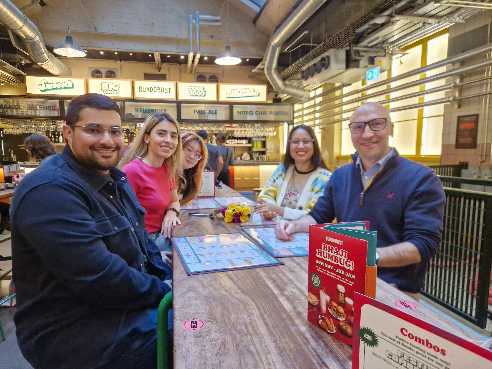

<!-- Can we accurately screen MOFs for carbon capture applications using high throughput computational screening workflows?    -->

<!--more-->

Lot of things are happening in our group. Zahra has joined in September to originally work broadly on water in MOFs – but it is now clear that the focus of the project will be design of neuromorphic MOFs together with the group of Prof. Martin Schröder in Chemistry. 

Also, we had some group outings celebrating some personal milestones in the group 😊. In November, Lev is going to the AIChE meeting to contribute to the session dedicated to 60th birthday of Prof. Randy Snurr.  And it is time to wrap up some papers on phase behaviour of solvents in MOFs, busy times but in a good way.

<figure>
  
  <figcaption>
</figure>

